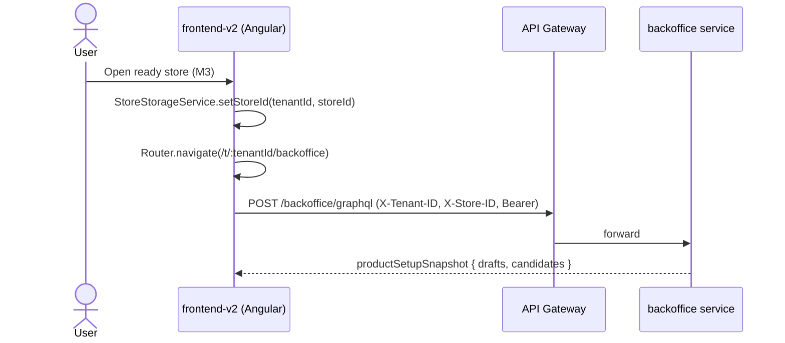

# PZEP-0011: Angular Backoffice minimal shell — store-scoped home page + one protected API call

## Status
Done — implemented and verified this session (`ng build`, `format:check`,
`ng test` all pass). Manual QA against a live Docker dev backend (this
document's own Test Plan) has **not** been run — no Docker environment
available in this session. Treat AC-1/AC-2 as code-complete, not yet
click-through-verified.

## Date
2026-07-25

## Related Commit
(none yet — implemented uncommitted in the working tree this session)

## Requirement Sources
- Business: recovery backbone completion — CLAUDE.md's "Current Recovery
  Target" ends at "open store-scoped Backoffice -> call one protected
  business API"; that step currently has nowhere to land.
- Feature: continues [PZEP-0008](./PZEP-0008-angular-onboarding-backbone-integration.md)
  M3 (handoff), and [ADR-0007](../08-adr/ADR-0007-frontend-v2-sole-active-app-frontend-frozen.md)
  (`frontend/` frozen, no longer serving traffic).
- Use Cases: after opening a ready store, the user lands on a real,
  store-scoped Backoffice page inside `frontend-v2` and sees data from one
  genuinely protected (JWT + tenant + store scoped) backend query.
- Functional Requirements: `docs/01-srs/onboarding/SRS-ONB-001-workspace-and-store-entry.md`
  (the backbone this closes the loop on).
- Non-functional Requirements: `agent/ANGULAR_STYLE_GUIDE.md`.
- Acceptance Criteria: see below.
- UI Specs: none new — reuses the design system already ported (PZEP-0007/
  ADR-0006).

## Summary

PZEP-0008's M3 was written when `frontend/` (SolidJS) was still serving
production traffic and explicitly designed the "Open Backoffice" action as
a **full cross-app navigation** to that app's store-scoped Backoffice
route, because porting Backoffice itself was out of scope at the time.

[ADR-0007](../08-adr/ADR-0007-frontend-v2-sole-active-app-frontend-frozen.md)
changed that: `frontend/` is now frozen and **not running**. M3's handoff
link currently points at an origin nothing serves — the recovery backbone's
final step ("open store-scoped Backoffice -> call one protected business
API") cannot be exercised at all right now.

This PZEP ports the **smallest possible real slice** of Backoffice into
`frontend-v2` to close that gap: one store-scoped home route, one
`Injectable` service, one protected GraphQL query. It deliberately does
**not** port Backoffice's other five pages (orders, catalog/product-setup
detail, routing, order-finance, order-audit, partners) — those are real,
separate, larger efforts that each deserve their own PZEP once this
foundation (the GraphQL client + tenant/store header plumbing + routing
shape) exists to build on.

## Problem

`frontend/apps/backoffice` has 7 routes and ~58 files (per PZEP-0004's
original Phase 4 estimate). All of it currently sits behind a full-page
navigation to an app that is turned off. The recovery backbone needs
exactly one thing to be end-to-end testable again: somewhere for M3's
handoff to land, that is real (not a stub) and makes a real protected API
call, matching CLAUDE.md's stated recovery target precisely — not the full
Backoffice feature set.

## Goals

- `core/http`-adjacent GraphQL client for the backoffice service
  (`features/backoffice/backoffice-graphql.service.ts`, `providedIn: 'root'`
  — domain-scoped to the backoffice GraphQL endpoint, not `shared/` per
  `agent/ANGULAR_STYLE_GUIDE.md`'s boundary rule that `shared/` must stay
  domain-neutral). Ported from `frontend/packages/shared/services/
  backofficeGraphql.ts`: POSTs to `environment.graphqlApiUrl`, attaches
  `X-Tenant-ID` and `X-Store-ID` headers (Authorization already handled by
  the existing `authInterceptor`), surfaces GraphQL `errors[]` as feature
  error state per `agent/ANGULAR_STYLE_GUIDE.md`'s "expected transport
  failures stay in feature state" rule.
- `core/storage/store-storage.service.ts` — port of `frontend/packages/
  shared/services/storeStorage.ts` (per-tenant active-store-id map in
  `localStorage`, key `x_store_id_by_tenant`), mirroring
  `TenantStorageService`'s existing shape. Needed so a store, once opened,
  has a durable "active store for this tenant" the way `TenantStorageService`
  already tracks the active tenant.
- `features/backoffice/tenant-home-page/` — one route component + one
  `TenantHomeService` (route-scoped `@Injectable()`, per the one-service-
  owns-remote-reads convention) calling a single GraphQL query,
  `productSetupSnapshot { drafts { id } candidates { id status } }`
  (a subset of the fields `frontend/`'s home page queried — just enough to
  show two real counts, not the full ported dashboard). Renders: store name/
  id, draft count, candidate count, loading/error states. This is the "one
  protected business API call" CLAUDE.md's recovery target names.
- New route `/t/:tenantId/backoffice`, gated by the existing `authGuard`
  (no new guard — matches `admin-home-page`/`store-chooser-page`'s current
  gating; a store-scope-specific guard is a real gap but pre-existing, not
  introduced by this PZEP, and out of scope here).
- M3's handoff action changes from a raw `<a href>` (cross-app navigation,
  correct when the target was a different running app) to
  `Router.navigate()` (per `agent/ANGULAR_STYLE_GUIDE.md`'s "internal
  navigation, never a raw anchor" rule — now correct because the target is
  inside `frontend-v2` itself). The active store id is persisted via the
  new `StoreStorageService` before navigating.
- `environment.backofficeBaseUrl` and its cross-app-navigation comment are
  removed (only consumer was `store-chooser.component.ts`'s old `<a href>`
  URL builder, replaced by the above); `environment.graphqlApiUrl` added.

## Non-Goals

- Porting any other Backoffice route/page (orders, product-setup detail,
  routing/order-audit/order-finance, partners). Each is a real, separately
  scoped effort — this PZEP only proves the pattern (GraphQL client,
  tenant/store headers, routing shape) that those would build on.
- A store-scope-specific route guard (verifying the JWT's tenant actually
  has access to *this* store, not just that the user is authenticated) —
  pre-existing gap in `frontend-v2`, not introduced here, flagged as a
  follow-up.
- Any backend change — this reuses the existing `productSetupSnapshot`
  GraphQL query and existing tenant/store-header contract verbatim.
- A permanent home for `frontend-v2`'s eventual full Backoffice IA/nav
  shell (sidebar, sections) — this PZEP is one bare page, not a shell
  redesign. A real Backoffice shell is scoped when the next page is ported.
- Deciding whether `frontend/`'s frozen Backoffice code should be deleted
  now that porting has started — ADR-0007 already defers that.

## Proposed Solution

```text
frontend-v2/src/app/
  core/storage/store-storage.service.ts        (new)
  features/backoffice/
    backoffice-graphql.service.ts               (new)
    tenant-home-page/
      tenant-home-page.component.{ts,html,scss} (new)
      tenant-home.service.ts                    (new)
  environments/environment*.ts                  (add graphqlApiUrl, remove backofficeBaseUrl)
  app.routes.ts                                 (add /t/:tenantId/backoffice)
  features/onboarding/store/store-chooser/
    store-chooser.component.{ts,html}           (Open -> Router.navigate)
```

`TenantHomeService` shape (mirrors `OnboardingStoreService`'s existing
pattern in this codebase):

```ts
@Injectable()
export class TenantHomeService {
  private readonly _tenantId = signal('');
  private readonly _storeId = signal('');
  readonly snapshot = resource({
    params: () => (this._tenantId() && this._storeId()
      ? { tenantId: this._tenantId(), storeId: this._storeId() } : undefined),
    loader: async ({ params }) => { /* postBackofficeGraphQL via BackofficeGraphqlService */ },
  });
}
```

## Affected Components
- Frontend: `frontend-v2/src/app/{core/storage,features/backoffice,
  features/onboarding/store/store-chooser,environments,app.routes.ts}`
- Gateway: none (calls existing APISIX-fronted `/backoffice/graphql` route)
- Backend: none — reuses the existing `productSetupSnapshot` query
  documented in the backoffice GraphQL schema
- Worker/Database/External Integration: none

## Runtime Flow



## API Contract Changes
- None. Consumes the existing `productSetupSnapshot` GraphQL query
  unchanged.

## DB / Event Contract Changes
- None.

## Permission Changes
- None. Same `X-Tenant-ID`/`X-Store-ID`-scoped GraphQL authorization the
  backend already enforces for this query — frontend adds no new check and
  relies on none as a security boundary, per
  `docs/00-governance/agent-working-rule.md`.

## Security Considerations
- Authentication/authorization: unchanged, backend-enforced.
- Tenant/store isolation: `X-Tenant-ID`/`X-Store-ID` headers set from
  `TenantStorageService`/`StoreStorageService` before every call, same
  mechanism `frontend/` used — the GraphQL call must not fire without both
  resolved, matching the existing `ensureActiveTenant`-before-call guard
  pattern already used in `onboarding`.
- Sensitive data: none new.

## Test Plan
- Unit: none required at this stage, per `agent/ANGULAR_STYLE_GUIDE.md`'s
  existing "frontend unit tests optional" policy (same as PZEP-0008).
- Manual QA: `ng build`, then click-through against real Docker dev
  backend once available — login -> workspace -> store -> (readiness
  ready) -> Open -> lands on `/t/:tenantId/backoffice` -> drafts/candidates
  counts render from a real GraphQL response.

## Agent Implementation Plan
- TASK-0001: `core/storage/store-storage.service.ts`. Done.
- TASK-0002: `features/backoffice/backoffice-graphql.service.ts`. Done.
- TASK-0003: `features/backoffice/tenant-home-page/` (service + component).
  Done. `TenantHomePage` resolves `storeId` from the query param first,
  falling back to `StoreStorageService` for direct/reload navigation
  (mirrors `frontend/`'s `TenantWorkspaceProvider.initialStoreID`) — a small
  addition beyond the PZEP's original wording, needed so the page isn't
  broken on a plain reload.
- TASK-0004: route registration + `authGuard`. Done (`/t/:tenantId/backoffice`).
- TASK-0005: M3 handoff. Done, implemented as: `StoreChooser` (presentational,
  per its existing input/output-only shape) gained an `openStore =
  output<StoreRequest>()` instead of injecting `Router` itself;
  `StoreChooserPage` (the route component that already owns
  `onCreateStore`/`onRetryStore`) handles it with
  `router.navigate(['/t', tenantId, 'backoffice'], { queryParams: { storeId } })`.
  `environment.backofficeBaseUrl` removed; `environment.graphqlApiUrl` added.
  (Plain `[routerLink]="url"` was considered and rejected — Angular's
  `routerLink` does not parse a `?storeId=...` suffix out of a string input,
  so the store id would not have reached the query params correctly.)

## Acceptance Criteria Mapping

| AC | Task | Test |
|---|---|---|
| AC-1: opening a ready store navigates internally (no full page reload) to `/t/:tenantId/backoffice` | TASK-0005 | Manual QA |
| AC-2: the Backoffice home page renders real drafts/candidates counts from a live `productSetupSnapshot` call | TASK-0003 | Manual QA |
| AC-3: the GraphQL call carries `X-Tenant-ID`/`X-Store-ID` and fails closed (feature error state, not a thrown exception) on a GraphQL `errors[]` response | TASK-0002 | Manual QA + code review |
| AC-4: `environment.backofficeBaseUrl` and its now-obsolete cross-app comment are removed | TASK-0005 | Code review |

## Open Questions
- Whether `/t/:tenantId/backoffice` is this route's permanent path once
  more pages are ported (v1 used `/t/:tenantId` with no `/backoffice`
  suffix) — deferred to whichever PZEP ports the next page; not worth
  deciding against a one-page shell now.
