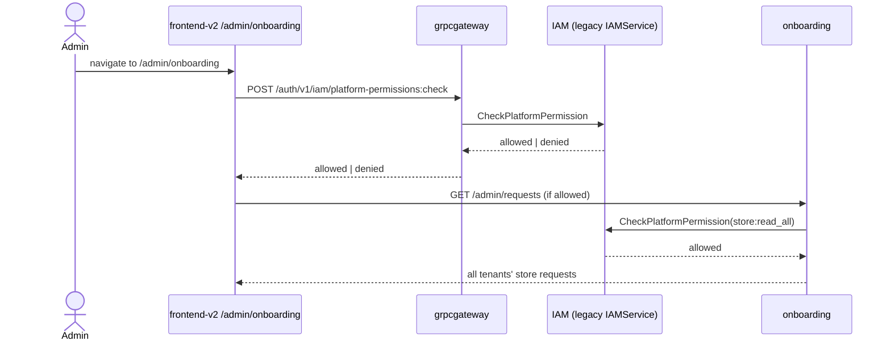

# PZEP-0020: frontend-v2 admin console — cross-tenant onboarding review, readiness debug, IAM section

## Status
Done — tenant directory dropped (no backend RPC; see Open Questions)

## Date
2026-07-27

## Related Commit
(uncommitted at PZEP completion — see Rollout Log)

## Requirement Sources
- Business: `docs/00-project-vision/02-actors-and-business-flows.md`
  ("System Admin / Platform Operator", "Organization Root / Organization
  Admin" actors) — these roles currently have no operational UI anywhere
  in the active frontend.
- Feature: none pre-existing — this is a new admin surface, not an
  extension of a documented feature.
- Use Cases: a platform admin reviews pending store-onboarding requests
  across every tenant and approves/rejects them; a platform admin debugs
  one tenant's placement/readiness state without shell access; a platform
  admin manages IAM (organizations, tenants, roles, policies) from a
  working UI instead of the frozen SolidJS one.
- Functional Requirements: [SRS-IAM-004](../01-srs/iam/SRS-IAM-004-platform-admin-bootstrap-and-recovery.md)
  (this PZEP is the first real *consumer* of the platform-admin identity
  [PZEP-0002](./PZEP-0002-platform-admin-bootstrap-and-recovery.md)
  bootstraps — until now nothing in any active frontend used a
  platform role for anything).
- Non-functional Requirements: [SRS-NFR-002](../01-srs/podzone-srs.md) Fail
  Closed Authorization.
- Acceptance Criteria: see below.
- UI Specs: none pre-existing — new screens, following `ADR-0008`'s
  declarative collection pattern and the `Shell` composition pattern
  already established by PZEP-0011/0012/0013/0014.

## Summary

Three new admin-only areas under a new `/admin` route prefix in
`frontend-v2` (the sole active frontend, per `ADR-0007`):

1. **Onboarding review** (`/admin/onboarding`) — a collection screen
   listing store-onboarding requests **across every tenant**, with
   Approve/Reject actions per row.
2. **Readiness debug** (folded into the same screen, per-row expand or a
   detail route) — look up one request's placement/readiness state
   (`ReadinessResponse`) regardless of which tenant it belongs to.
3. **IAM section** (`/admin/iam`) — organizations, tenant directory,
   roles/policies, built **as a section inside `frontend-v2`**, not a
   separate deployable app/MFE remote. `frontend-v2` currently builds via
   `@angular-architects/native-federation` but consumes zero remotes
   (confirmed: `federation.config.mjs` only *exposes* itself); reopening
   the old SolidJS `frontend/apps/iam`-style separate-remote architecture
   would mean either standing up a second Angular project or finishing
   native-federation's remote-consumption path, which `PZEP-0005` already
   found incomplete as of its spike and which `ADR-0007` explicitly
   demoted ("no longer on the critical path"). Building this as a section
   avoids reopening that architecture decision.

Two of the three screens need a **small, narrowly-scoped backend change**
first: `ListStoreRequests` and `GetStoreReadiness`
(`internal/onboarding/domain/store/interactor.go`) are both hard-scoped to
the caller's own `workspaceID` (from `toolkit.GetTenantID(ctx)`) — an admin
account has no tenant membership in most tenants, so these would 404/deny
for almost every request. `ApproveStoreRequest`/`RejectStoreRequest`
already avoid this problem — they authorize via
`CheckPlatformPermission(userID, "store:approve")`
(`internal/onboarding/infrastructure/iamclient/access_authorizer.go:110-129`),
a platform-scoped check with no tenant-boundary crossing at all. This PZEP
adds two new admin-scoped read paths using the **exact same pattern**
(`store:read_all`, checked via `CheckPlatformPermission`, no tenant
matching) — this deliberately avoids needing
[ADR-0003](../08-adr/ADR-0003-platform-scope-tenant-access-override.md)'s
proposed (not accepted) cross-tenant permission-override branch in IAM's
core `CheckPermissionForResource`: that mechanism would let a platform
role reach into *any* tenant-scoped permission check generically, which is
a much bigger, more security-sensitive change than this PZEP needs. Read
access to store-request metadata for review purposes is exactly the kind
of narrow, purpose-built platform permission `store:approve` already
established the precedent for (`internal/iam/migrations/sql/
0024_add_store_approval_permission.sql` — register the permission, attach
to `platform_owner`/`platform_admin` by default) — this PZEP follows that
same precedent for `store:read_all` rather than opening the more general
ADR-0003 question.

## Problem

- No admin/platform-level UI exists anywhere in `frontend-v2` today.
  Confirmed: `frontend-v2/src/app/core/auth/auth.guard.ts` has exactly one
  guard (`authGuard`) checking only "is a session present" — no
  permission check of any kind, client-side.
- `ListStoreRequests(ctx, workspaceID, query)` requires a `workspaceID`
  resolved from the caller's own auth context
  (`internal/onboarding/domain/store/interactor.go:251-`) — there is no
  way to list requests across tenants today.
- `GetStoreReadiness(ctx, id)` explicitly 404s when
  `req.WorkspaceID != workspaceID` (`interactor.go:675-677`) — an admin
  without a tenant membership in the target tenant cannot look up its
  readiness state at all.
- The one prior UI for IAM management (`frontend/apps/iam`, frozen
  SolidJS) is out of favor with the product owner ("v1 cũng không đúng ý")
  and frozen per `ADR-0007` regardless.
- IAM's newer split `IAMCommandService`/`IAMQueryService` RPCs are gRPC-only
  — not reachable from a browser (no grpc-web anywhere in this stack).
  Only the legacy monolithic `IAMService` has REST mappings registered
  through `grpcgateway` (`internal/grpcgateway/registrar_iam.go`). The IAM
  section in this PZEP can only call the legacy REST surface as a result —
  this is a real constraint on what the IAM section can do at launch, not
  a design choice.

## Goals

- `platformAdminGuard` (new, `frontend-v2/src/app/core/auth/`) — calls
  `POST /auth/v1/iam/platform-permissions:check` (legacy `IAMService`,
  already REST-mapped, already used server-side by `AuthorizeStoreApproval`)
  with the signed-in user's ID and a permission name, gating every
  `/admin/*` route. Fails closed: no session, no permission response, or
  `allowed: false` all deny.
- New platform permission `store:read_all` (migration, same shape as
  `0024_add_store_approval_permission.sql`), attached to `platform_owner`/
  `platform_admin` by default — same precedent that permission already
  set.
- `internal/onboarding`: new interactor methods `ListAllStoreRequests(ctx,
  query)` and `GetStoreReadinessAsAdmin(ctx, id)` — both authorize via
  `CheckPlatformPermission(userID, "store:read_all")` (new
  `AuthorizeStoreReadAll` on `AccessAuthorizer`, mirroring
  `AuthorizeStoreApproval`'s exact shape), then call a new repository
  method with **no** `workspaceID` filter (`ListAllStoreRequests` on
  `StoreRepository`) / skip the workspace-match check entirely (readiness
  path). New HTTP routes under `/admin/requests` (distinct route group
  from the existing tenant-scoped `/requests`, same controller file).
- `frontend-v2`: `/admin/onboarding` — `ADR-0008` declarative collection
  screen (`CollectionFieldSpec`) listing all store requests, filterable by
  status/tenant, with Approve/Reject row actions calling the **existing,
  unchanged** `POST /requests/:id/approve` / `/reject` endpoints (already
  platform-permission-gated, no backend change needed there). Row
  expand/detail shows the readiness state via the new admin endpoint.
- `frontend-v2`: `/admin/iam` — organizations list, tenant directory,
  roles/policies views, calling the legacy `IAMService` REST surface via
  `grpcgateway`. Exact RPC-to-screen mapping is an implementation detail
  for the Agent Implementation Plan, not enumerated here — see Open
  Questions for which legacy RPCs are actually usable today.
- All three screens follow the `Shell` + tenant-home-page composition
  pattern already established (PZEP-0011/0013) for visual/structural
  consistency with the rest of the app, even though `/admin/*` is not
  tenant-scoped (the Shell's tenant-switcher chrome is not applicable
  here — confirm during implementation whether `/admin/*` needs its own,
  simpler top-level layout instead of reusing `Shell` verbatim).

## Non-Goals

- **Accepting or implementing ADR-0003** (the general platform-scope
  permission-override branch in `CheckPermissionForResource`) — this PZEP
  deliberately sidesteps that larger, still-Proposed architectural
  question by using narrow, purpose-built platform permissions instead
  (see Summary). If a future need genuinely requires *generic* cross-tenant
  reach (not just these two read paths), that's ADR-0003's question to
  resolve on its own, not silently absorbed here.
- **A separate deployable app/MFE remote for IAM** — explicitly decided
  against for this PZEP (see Summary); revisit only if `ADR-0007`/native
  federation's remote-consumption gap is deliberately reopened later.
- **Write operations in the IAM section beyond what legacy `IAMService`
  already exposes over REST** — no new IAM write RPCs, no grpc-web bridge
  for the newer CQRS services. If a needed IAM management action only
  exists on the gRPC-only `IAMCommandService`, it is out of scope for this
  PZEP's first cut (flag it, don't build a workaround).
- **`store:read_all` granting anything beyond store-request metadata** —
  does not grant access to a tenant's actual product/catalog/routing data,
  only the `StoreRequest` aggregate onboarding already owns.
- Wave 6/7 (`PZEP-0019`, tenancy/infra scaling) — unrelated.

## Proposed Solution

1. **IAM migration**: new file
   `internal/iam/migrations/sql/00XX_add_store_read_all_permission.sql`,
   identical shape to `0024_add_store_approval_permission.sql` with
   `store:read_all` / resource `store` / action `read_all`.

2. **`internal/onboarding/infrastructure/iamclient/access_authorizer.go`**:
   add `AuthorizeStoreReadAll(ctx, requestedBy string) error`, copying
   `AuthorizeStoreApproval`'s exact shape with permission
   `"store:read_all"`.

3. **`internal/onboarding/domain/store/outputport/repository.go`**: add
   `ListAllStoreRequests(ctx, query collection.Query) (collection.Page[
   entity.StoreRequest], error)` — same shape as the existing
   `ListPage`/`ListPageByUser`-style methods elsewhere in this codebase,
   just with no tenant filter predicate.

4. **`internal/onboarding/domain/store/interactor.go`**: add
   `ListAllStoreRequests(ctx, query)` (calls `AuthorizeStoreReadAll` then
   the new repo method) and `GetStoreReadinessAsAdmin(ctx, id)` (calls
   `AuthorizeStoreReadAll`, then the existing readiness-computation logic
   from `GetStoreReadiness` minus the workspace-match check — factor the
   shared computation into a private helper both public methods call,
   don't duplicate it).

5. **`internal/onboarding/controller/httphandler/store/controller.go`**:
   new route group (e.g. `admin.GET("/requests", c.ListAllStoreRequests)`,
   `admin.GET("/requests/:id/readiness", c.GetStoreReadinessAsAdmin)`),
   gated the same way every other route already is (auth middleware
   extracts `requestedBy`; the interactor methods themselves enforce
   `store:read_all`).

6. **`frontend-v2/src/app/core/auth/platform-admin.guard.ts`** (new):
   calls the legacy REST endpoint, caches the result for the route
   activation only (no long-lived client-side permission cache — always
   re-check on navigation into `/admin/*`, matching how `authGuard`
   already behaves for session checks).

7. **`frontend-v2/src/app/features/admin/`** (new feature area):
   `onboarding-review-page/` (collection screen + readiness detail) and
   `iam/` (organizations/tenants/roles/policies sub-sections) — exact
   component breakdown left to implementation, following the
   `store-list-page`/`routed-order-list-page` shape already established.

8. **`frontend-v2/src/app/app.routes.ts`**: new `admin` route tree under
   `platformAdminGuard`, sibling to the existing `t/:tenantId` tree (not
   nested under it — `/admin` is not tenant-scoped).

## Affected Components
- Frontend: `frontend-v2` (new `admin` feature area, new guard)
- Gateway: none new — reuses existing `grpcgateway` REST mapping for
  legacy `IAMService`
- Backend: `internal/onboarding` (two new interactor methods, one new
  repository method, two new HTTP routes), `internal/iam` (one migration)
- Worker/Database schema/External Integration: none

## Runtime Flow

## API Contract Changes
- New REST routes: `GET /admin/requests`, `GET /admin/requests/:id/readiness`
  on `internal/onboarding`'s existing HTTP surface.
- No change to any existing route's request/response shape.

## DB Contract Changes
- IAM: one new `iam_permissions` row + `iam_role_permissions` rows
  (migration, no table/column change).
- Onboarding: none — reads existing `StoreRequest` data with a different
  filter, no schema change.

## Event Contract Changes
None.

## Permission Changes
- New platform permission `store:read_all`, granted to `platform_owner`/
  `platform_admin` by default (matches `store:approve`'s existing
  precedent). No existing permission's behavior changes.

## Error Codes
- New endpoints reuse existing error mapping (`ErrAccessDenied`,
  `ErrStoreNotFound`) — no new error codes introduced.

## Data Ownership
- Owner component: `internal/onboarding` (StoreRequest aggregate,
  unchanged), `internal/iam` (permission catalog, unchanged shape)
- Read/write owner: unchanged
- Projection/read-model owner: N/A

## Security Considerations
- Authentication: `/admin/*` still requires a valid session
  (`platformAdminGuard` checks permission, not identity — identity is
  still the existing session mechanism).
- Authorization: fail-closed by construction — both the new client-side
  guard and the new server-side interactor methods independently check
  `store:read_all`; the guard alone is not a security boundary (per this
  repo's own rule: "Do not use frontend permission checks as security
  boundaries"), it only prevents an unauthorized user from *seeing* the
  admin UI shell before the backend rejects the actual data calls.
- Tenant/workspace/store isolation: this PZEP narrowly crosses tenant
  boundaries for **read-only store-request metadata only**, via a
  purpose-built platform permission — not a generic override. See Summary
  for why this is deliberately narrower than ADR-0003.
- Sensitive data: `StoreRequest` metadata (subdomain, requester, status)
  is not itself highly sensitive, but is now readable platform-wide by
  anyone holding `store:read_all` — restricting default grant to
  `platform_owner`/`platform_admin` only (not a broader role) keeps this
  consistent with `store:approve`'s existing blast radius.

## Observability
- Logs: standard `pdlog` request logging, unchanged pattern.
- Metrics: none new.
- Traces: none new.
- Alerts: none new — this is an internal admin tool, not a customer-facing
  path.

## Alternatives Considered

### Option A: Accept and implement ADR-0003 first, build screens on top of the generic override
Pros:
- Solves the general "platform role needs tenant-scoped access" problem
  once, reusable for every future admin screen, not just onboarding.

Cons:
- Much larger, more security-sensitive change to IAM's core
  `CheckPermissionForResource` — ADR-0003 itself calls for its own
  follow-up PZEP before implementation, and is a bigger sign-off ask than
  this PZEP's actual need (two narrow read paths).
- Blocks this PZEP on a separate architectural decision instead of
  shipping the two purpose-built permissions this PZEP actually needs.

### Option B: Purpose-built platform permissions (this proposal)
Pros:
- Matches the exact precedent `store:approve` already established and
  already works in production-shaped code (`AuthorizeStoreApproval`).
- Ships without touching IAM's core authorization logic at all.

Cons:
- Doesn't generalize — a *third* future admin screen needing cross-tenant
  reach would need its own purpose-built permission too, rather than
  automatically inheriting from a generic mechanism. Acceptable trade-off
  given how narrow the current need is.

### Option C: IAM as a separate frontend app/remote
Pros:
- Matches the old architecture's separation of concerns; IAM could be
  extracted as a standalone product later with less rework.

Cons:
- Explicitly rejected by the product owner for this PZEP's scope; requires
  reopening `ADR-0007` and finishing native-federation's incomplete
  remote-consumption path first. Revisit only as its own, later decision.

## Test Plan
- Unit: `AuthorizeStoreReadAll` (mocked IAM client, allowed/denied cases);
  `ListAllStoreRequests`/`GetStoreReadinessAsAdmin` interactor methods
  (mocked repo, assert no workspace filter is applied); `platform-admin.guard.ts`
  (mocked HTTP client, allowed/denied/no-session cases).
- Integration: HTTP route test for the two new endpoints (matching
  existing `internal/onboarding/controller/httphandler` test conventions).
- E2E: not automated this session — matches this repo's established
  pattern of manual QA for new frontend screens (no browser tool
  available to the agent).
- Manual QA: bootstrap a platform admin via `cmd/iam-bootstrap`
  (PZEP-0002), sign in as that account, confirm `/admin/onboarding` shows
  requests from multiple tenants and Approve/Reject work, confirm a
  non-admin account gets denied entry to `/admin/*`.

## Agent Implementation Plan
- TASK-0001: IAM migration for `store:read_all`. Done —
  `internal/iam/migrations/sql/0030_add_store_read_all_permission.sql`.
- TASK-0002: `AuthorizeStoreReadAll` + onboarding interactor/repository/
  route additions (list-all, readiness-as-admin). Done.
- TASK-0003: `platformAdminGuard` + `/admin` route tree scaffold in
  `frontend-v2`. Done — `AdminShell` is a dedicated top-level layout, not
  `Shell` reused verbatim (see Open Questions resolution below).
- TASK-0004: `/admin/onboarding` collection screen + readiness detail.
  Done — readiness is a separate detail route (`/admin/onboarding/:id`),
  not an inline row-expand (`app-data-table` has no expansion-row support).
- TASK-0005: `/admin/iam` section. Done, reduced scope — Organizations,
  Platform Roles, Policies only. Tenant directory dropped: the legacy
  `IAMService` has no RPC to list tenants platform-wide or per-organization
  (only `CreateTenant`, `ListUserTenants` (per-user), `ListTenantMembers`
  (per-tenant) exist) — confirmed by a full pass over
  `api/proto/iam/v1/iam_service.proto`'s `google.api.http` annotations.
  Building a fake screen without a backing RPC was rejected in favor of
  shipping the three screens with real contracts; user confirmed
  (`AskUserQuestion`, "Drop tenant directory, ship Org+Roles+Policies").
- TASK-0006: test coverage per Test Plan. Backend unit + integration tests
  done (interactor + HTTP handler). Frontend: no test harness exists for
  feature components/services in this repo yet (only one pre-existing spec
  file, unrelated) — `platform-admin.guard.ts` and the new services/pages
  are covered by `ng build`/`prettier --check` only, per this repo's own
  "no browser tool available to the agent" Test Plan note; manual QA still
  needed (see Test Plan).

## Acceptance Criteria Mapping

| AC | Task | Test |
|---|---|---|
| AC-1: a platform admin can list store requests across every tenant, not just their own | TASK-0002 | Unit + integration test |
| AC-2: a platform admin can view readiness for a request in a tenant they have no membership in | TASK-0002 | Unit + integration test |
| AC-3: an account without `store:read_all` is denied both new endpoints | TASK-0002 | Unit test |
| AC-4: `/admin/*` is unreachable (redirected/blocked) for a session without platform permission | TASK-0003 | Unit test (guard) + manual QA |
| AC-5: Approve/Reject from the new admin screen use the existing, unchanged endpoints — no duplicate approval code path | TASK-0004 | Manual QA |
| AC-6: the IAM section only calls RPCs actually reachable via the legacy `IAMService` REST mapping — no gRPC-only call attempted from the browser | TASK-0005 | Manual QA / code review |

## Open Questions

Resolved during implementation:

- Exact set of legacy `IAMService` RPCs usable for the IAM section —
  confirmed via a full pass over `api/proto/iam/v1/iam_service.proto`'s
  `google.api.http` annotations. Buildable with real contracts:
  Organizations (`ListOrganizations`, `CreateOrganization`,
  `ListOrganizationMembers`, `AddOrganizationMember`,
  `RemoveOrganizationMember`, `AttachTenantToOrganization`,
  `DetachTenantFromOrganization`), Platform Roles (`ListPlatformRoles`,
  `AddPlatformRole`, `RemovePlatformRole`), Policies (`ListPolicies`,
  `ListPolicyVersions`, `ListPolicyAttachments`). **Not buildable**: a
  tenant directory — no RPC lists tenants platform-wide or per-org.
  Dropped per user decision (see Agent Implementation Plan TASK-0005).
- `/admin/*` gets its own dedicated `AdminShell` layout, not `Shell` reused
  verbatim — `Shell`'s nav items are computed from a required `:tenantId`
  route param and its workspace-switcher chrome is tenant-scoped
  (PZEP-0006/0011); `/admin` has neither. `AdminShell` mirrors `Shell`'s
  visual structure (sidebar/header/footer chrome, same SCSS variables) for
  consistency but with its own fixed nav items (Onboarding review,
  Organizations, Platform roles, Policies).
- Readiness debug is a separate detail route (`/admin/onboarding/:id`), not
  an inline per-row expand — `app-data-table` has no row-expansion
  support, and the PZEP text allowed either shape.
- `store:read_all` gates `/admin/onboarding`; the existing
  `platform:manage_roles` permission (platform_owner only by default, no
  new migration) gates all of `/admin/iam` — IAM management is more
  sensitive than onboarding review, so restricting to the more privileged
  role by default matches SRS-NFR-002's fail-closed posture. Revisit if a
  narrower "org admin" role short of full `platform_owner` needs IAM
  section access later.
- Pagination shape for `/admin/requests` reuses `collection.Query`
  end-to-end (`toCollectionParams`, newly ported to `collection-types.ts`
  from `frontend/`'s REST form) — filters are supported by the underlying
  contract (`requestCollectionFields`) but the shipped `/admin/onboarding`
  screen's `CollectionFieldSpec` only marks the same 9 fields
  `requestCollectionFields` allows as filterable/sortable, matching
  ADR-0008. Organizations/Policies lists intentionally ship without a
  filters UI (search + sort + pagination only) — no confirmed backend
  filter-field allowlist exists for those legacy `IAMService` list RPCs, so
  offering filter fields would risk an invented, unsupported request shape.

## Rollout Log

- 2026-07-27/28: Backend implemented and verified — IAM migration
  (`0030_add_store_read_all_permission.sql`), `AuthorizeStoreReadAll`,
  `ListAllPage`/`buildAllStoreRequestCollection` (with an empty-`$and`
  MongoDB bug caught and fixed in the cross-tenant, no-base-clause path),
  `ListAllStoreRequests`/`GetStoreReadinessAsAdmin`/`authorizeReadAll` on
  the interactor (shared `computeReadiness` helper factored out of
  `GetStoreReadiness`, using `req.WorkspaceID` not the caller's context
  tenant), two new HTTP routes under `/admin/requests`. Mocks regenerated
  twice (outputport, then inputport). `go build`, `go vet`, `go test
  ./internal/onboarding/...` clean throughout. Added controller tests
  (`TestController_ListAllStoreRequests_*`, `TestController_
  GetStoreReadinessAsAdmin_*`) and interactor tests (`TestListAllStoreRequests_*`,
  `TestGetStoreReadinessAsAdmin_*`), all passing.
- 2026-07-28: Frontend implemented — `toCollectionParams` added to
  `collection-types.ts` (REST form, the gap that file's own comment
  flagged); `platformAdminGuard` (fail-closed: no session/no permission/
  request error/`allowed:false` all deny); `AdminShell` (dedicated layout,
  not `Shell` reused); `/admin` route tree (`onboarding`, `onboarding/:id`,
  `iam/organizations`, `iam/platform-roles`, `iam/policies`); Onboarding
  Review (`ADR-0008` collection screen, Approve/Reject reusing the
  existing unchanged endpoints, client-side `canApprove`/`canReject`
  mirroring the backend's `isValidStatusTransition` for UX only); Readiness
  detail route; IAM section (Organizations, Platform Roles, Policies —
  ported wire types/endpoints from the frozen `frontend/packages/shared/
  services/iam/*` as the empirical ground truth for camelCase JSON field
  names and int64-as-string `PageInfo.total` handling, since no live
  gateway was available to verify against directly). `ng build`, `npm run
  format:check`, `npm run test` all clean. Not run: `ng serve`/manual QA
  (no browser tool available to the agent, matches this repo's established
  Test Plan pattern for new frontend screens) — see Test Plan's Manual QA
  step for what to verify by hand (bootstrap a platform admin via
  `cmd/iam-bootstrap`, sign in, confirm `/admin/onboarding` cross-tenant
  listing and Approve/Reject, confirm a non-admin is denied `/admin/*`).
- Not yet committed as of this log entry — all PZEP-0019 and PZEP-0020
  work is uncommitted in the working tree pending an explicit commit
  instruction.
